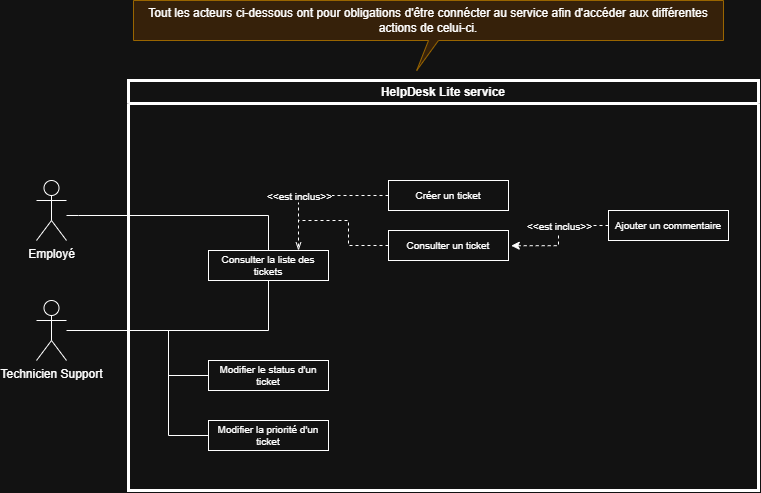

# Cahier des charges

____

## 1 - Pésentation du projet

##### <u>1.1 Nom du projet :</u>

Helpdesk Lite

##### <u>1.2 Contexte :</u>

Un collaborateur ou un client rencontre un problème qu'il n'arrive pas à résoudre et ne sais pas vers qui se tourner pour le solutionner ou être aider en priorité, si le besoin est vraiment urgent.

##### <u>1.3 Objectif principal :</u>

Mettre en place une plateforme qui permette de suivre les demande ou "ticket" des utilisateurs dans le besoin, tout en sachant l'ordre de priorité des demandes, leurs status, et qui est la personne en charge de la résolution.

## 2 - Utilisateur et rôle

##### <u>2.1 Type d'utilisateur :</u>

Les utilisateur de l'application seront :

1. <u>**L'administrateur :**</u> Il gère tout ce qui se passe dans l'application avec les droits maximum.

2. <u>**Les reviewers :**</u> ce qui vont traiter les demandes (CRUD sur demandes).

3. **<u>les utilisateurs :</u>** les personne qui demande un ticket (C,R sur demandes, C,R,U sur commantaires de demandes)

##### <u>2.2 Role et permission : </u>

- ADMIN : (CRUD sur tout)

- REVIEW : (CRUD sur demandes)

- MEMBER : (CR sur demande, SCRU sur commentaire)

## 3 - Fonctionnalités

##### <u>3.1 Les indispensables (MVP) : </u>

1. **Authentification et comptes**
- [ ] Se connecter et se déconnecter
- [ ] Gérer les rôles et les permissions des utilisateurs
2. **Gestion des tickets**
- [ ] Créer une demande de support
- [ ] Consulter la liste de ses tickets
- [ ] Consulter le détail d'un ticket
- [ ] Modifier ou compléter une demande selon les permissions
3. **Traitement des tickets**
- [ ] Consulter les tickets accessibles à l'agent
- [ ] Attribuer un ticket à un agent
- [ ] Modifier le statut d'un ticket
- [ ] Ajouter un commentaire à un ticket
4. **Suivi des demandes**
- [ ] Consulter le statut et l'historique d'un ticket
- [ ] Identifier les tickets ouverts, en cours et résolus

##### <u>3.2 Evolutions possible :</u>

- Notifications par e-mail lors d'un changement de statut.

- Priorité et catégorie des tickets.

- Pièces jointes.

- Recherche, filtres et pagination avancés.

- Tableau de bord avec statistiques.

- Gestion des équipes de support.

## 4 - Interface et parcours utilisateur

<figure>
    
    <figcaption>Diagramme de cas d'utilisation</figcaption>
</figure>

## 5 - Contraintes techniques

##### <u>5.1 Technologies choisies :</u>

Le choix technique ici est :

- <u>**Back-End :**</u> Java 17, Spring Boot 4, Gradle Groovey

- <u>**Front-End :**</u> Angular 21, TailwindCSS 4

- **<u>Moteur de recherche :</u>** MeiliSearch (Optionnel)

##### <u>5.2 Base de données :</u>

La base de donnée sera PostgreSQL 18.

##### <u>5.3 Sécurité :</u>

Une authentification JWT Auth  sera à mettre en place.

##### <u>5.4 déploiement :</u>

Le déploiement se fera dans un premier temps dans un container Docker.

## 6 - Critères de validation

Le MVP sera considéré comme validé lorsque les critères suivants seront respectés.

##### 6.1. Authentification et gestion des accès

- [ ] Un utilisateur peut se connecter avec des identifiants valides.

- [ ] Un utilisateur ne peut pas accéder aux fonctionnalités protégées sans être authentifié.

- [ ] Chaque rôle dispose uniquement des permissions qui lui sont attribuées.

##### 6.2. Création et consultation des tickets

- [ ] Un employé authentifié peut créer un ticket en renseignant les champs obligatoires.

- [ ] Un ticket créé possède un identifiant unique, une date de création et un statut initial.

- [ ] Un employé peut consulter ses propres tickets et leur détail.

- [ ] Un employé ne peut pas consulter les tickets privés d'un autre employé.

##### 6.3. Traitement des tickets

- [ ] Un agent de support peut consulter les tickets auxquels il a accès.

- [ ] Un agent autorisé peut attribuer un ticket à un membre du support.

- [ ] Un agent autorisé peut modifier le statut d'un ticket.

- [ ] Les modifications effectuées sont enregistrées et visibles lors de la consultation du ticket.

##### 6.4. Commentaires et suivi

- [ ] Un utilisateur autorisé peut ajouter un commentaire à un ticket.

- [ ] Les commentaires sont associés à leur auteur et à une date de création.

- [ ] Le statut actuel du ticket est visible par les utilisateurs autorisés.

- [ ] L'historique des actions prévues par le MVP peut être consulté.

##### 6.5. Qualité et livraison

- [ ] Les fonctionnalités principales sont couvertes par des tests adaptés.

- [ ] Les erreurs de saisie et les accès non autorisés sont correctement gérés.

- [ ] L'application peut être lancée à partir des instructions documentées dans le README.

- [ ] Le dépôt contient le code source, les instructions de configuration et les tests nécessaires.
